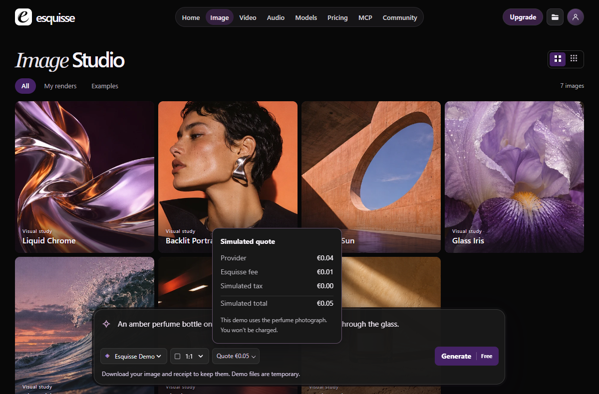

# Esquisse

We’re building Esquisse with the creators and developers who use it. You can try the demo, share what’s missing from your workflow, and help decide which tools we build next.

Esquisse is an open-source web studio for generative media, starting with images. Before you generate, you should be able to see what the model provider charges, what Esquisse keeps, and how much you’ll pay.

**[Try the demo](https://esquisse.top/image)** · [Get involved](#get-involved)

## Project status

The free demo simulates an image generation. You can change the lighting or crop, review the quote, then download the image and its receipt. [View the roadmap](ROADMAP.md)

## Get involved

**What’s missing from your creative workflow?** Tell us about the last time you ran into that problem. A concrete example gives other people something to build on.

- [Share an idea](https://github.com/EsquisseHQ/studio/discussions) — Suggest a tool, describe a frustration, or weigh in on someone else’s proposal.
- [Find a task](https://github.com/EsquisseHQ/studio/issues) — Pick up an issue, test a change, or help reproduce a bug.
- **Discord coming soon.**

Developers can start with the [setup instructions](CONTRIBUTING.md#developer-setup). Coding agents can follow [AGENTS.md](AGENTS.md). For more on how the community shapes Esquisse, visit the [wiki](https://github.com/EsquisseHQ/studio/wiki).

## License

Esquisse's code is released under the [MIT License](LICENSE). Integrated models and provider APIs have their own terms.
