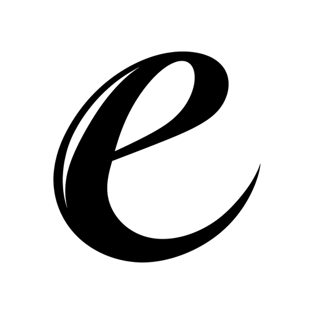

<p align="center"></p>

# Esquisse

Esquisse is a cooperative, open-source studio in development for generating images and video across multiple AI models. Before a creator starts a generation, they should be able to see what the provider charges, what the studio retains, and how much they will pay.

## Project status

The first local demo simulates a single image model. It varies the lighting of a fixed perfume photograph and crops it to the chosen format. Each attempt has a server-issued quote, a downloadable PNG and a JSON receipt. All prices are examples and the actual charge is zero. [Roadmap](ROADMAP.md) · [Engineering stack](STACK.md) · [First real generation](https://github.com/EsquisseHQ/studio/issues/1).

## Run the local studio

Use Node.js 24 LTS or newer and pnpm 11.25.0. From the repository root run:

```sh
pnpm install --frozen-lockfile
pnpm dev
```

Open the loopback address printed by Next.js. Edit the sample prompt, choose a format and review the quote beside the generation button. Generate a variation and download the PNG and receipt. Reload the page to recover the last attempt in this browser. The receipt references the accepted quote and lists the amount actually charged in cents.

The local-only demo uses SQLite in `.esquisse/` and needs no account, provider key or Docker daemon. Set `ESQUISSE_DATA_DIR` to choose a separate data directory. Quote calculation and the simulated provider are in [lib/server.ts](lib/server.ts). A single quote can produce one stored image and receipt. Each subsequent deliberate generation gets a new quote. This single-user demo is intended for loopback access. Shared accounts, PostgreSQL and the first real provider belong to later milestones.

To verify the demo, run `pnpm build`, `pnpm exec playwright install chromium` and `pnpm test:e2e`. The tests start a separate server with an isolated SQLite directory. To use an existing Chrome installation, set `PLAYWRIGHT_CHANNEL=chrome` instead of downloading Chromium.

## Help shape the studio

Read [The Esquisse Manifesto](MANIFESTO.md) for the pricing and governance proposals. To suggest an integration, [open an issue](../../issues/new) describing what you want to create, which model you use, and what you need to know before paying for a generation. The founder maintains the official releases during this first phase.

## License

Esquisse's code is released under the [MIT License](LICENSE). Integrated models and provider APIs have their own terms.
